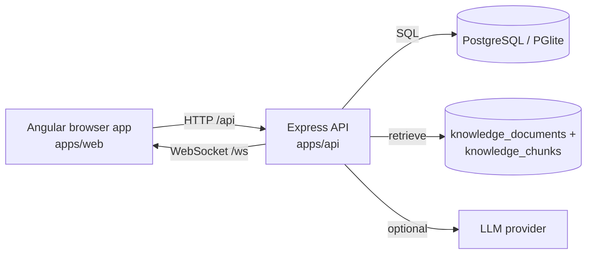

# Pet Vet AI — Code & Function Guide

A map of every source file in this repository and what its functions do, written so you can read the codebase from top to bottom and understand how a request travels through it.

Read this next to the code. File links are relative to the repository root.

---

## 1. How to run it

| What | Command | Notes |
| --- | --- | --- |
| Install | `npm run install:all` | Installs both `apps/api` and `apps/web` |
| Database | `docker compose up -d` | PostgreSQL 16 on `localhost:5433`; or leave `DATABASE_URL` empty and the API uses embedded PGlite in `.data/pg` |
| Migrate | `npm run migrate` | Applies `db/migrations/*.sql` in order |
| Seed | `npm run seed` | Reference catalogs only: species, breeds, food safety, knowledge, nutrition + vaccine rows. No people, pets or clinics — use `npm run create-admin` for the first administrator |
| API (dev) | `npm run dev:api` | `http://localhost:4000`, restarts on change |
| Web (dev) | `npm run dev:web` | `http://localhost:4200`, proxies `/api`, `/socket` and `/ws` to the API |
| Build web | `npm run build:web` | Outputs `apps/web/dist/pet-vet-ai`; the API serves it when present |
| Typecheck | `npm run typecheck` | `tsc --noEmit` for the API (the web app typechecks through `ng build`) |
| Tests | `npm test` | Node test runner against a throwaway PGlite database (`.data/test-pg`) |

Configuration lives in `.env` at the root and is read by [apps/api/src/config.ts](apps/api/src/config.ts).



---

## 2. Repository layout

```
apps/api/            Express + TypeScript API
  src/routes/        HTTP endpoints, grouped by feature
  src/services/      business logic, AI pipeline, retrieval, imports
  src/import-*.ts    workbook importers (CLI)
  scripts/           one-off maintenance and verification scripts
  test/              node:test suites
apps/web/            Angular 20 standalone app (signals + Material)
  src/app/core/      HTTP client, auth, websocket, guards, types
  src/app/pages/     one component per screen
  public/            static assets copied into the build (_routes.json)
db/migrations/       SQL schema, in application order
functions/           Cloudflare Pages Functions: /api/* and /socket proxies
infra/cloudflare/    the edge proxy those Functions call
render.yaml          Render blueprint for the API-only free service
docs/                API reference (docs/API.md) and this guide
```

---

## 3. The AI answer pipeline — the most important flow

Everything a chat question touches, in order. When you ask *"When is Bruno's rabies booster due?"*:

1. **`POST /api/ai/chat`** — [apps/api/src/routes/ai.ts](apps/api/src/routes/ai.ts)
   - Validates the body (`zod`), loads the pet through `loadPet` so ownership is enforced, counts today's messages against `AI_MAX_MESSAGES_PER_DAY` (default 80), creates or resumes the conversation, stores the user message, then calls `generateAiReply`.
2. **`generateAiReply`** — [apps/api/src/services/ai.ts](apps/api/src/services/ai.ts)
   - Reads the admin settings row (`settings.key = 'ai'`).
   - `detectEmergency(message, species)` from [emergency.ts](apps/api/src/services/emergency.ts). A match returns an urgent answer immediately and skips the rest.
   - `detectTask(message)` + `getCapability(species, task)` from [capability.ts](apps/api/src/services/capability.ts). `not_supported` returns a transparent "I don't have validated guidance" answer instead of guessing.
3. **The pet's own record** — [apps/api/src/services/pet-context.ts](apps/api/src/services/pet-context.ts)
   - `loadPetRecordFacts(petId)` gathers profile, conditions/allergies/medications, vaccination records, vaccination checkpoints, today's care plan, recent weight logs and appointments.
   - `relevantRecordLines(facts, message)` keeps only the lines that match the question's topic (vaccines, weight, appointments, care, food, conditions).
   - `recordPromptBlock(facts)` renders the whole record for the LLM system prompt (capped at 2,400 characters).
4. **Approved references** — [retrieval.ts](apps/api/src/services/retrieval.ts) + [nutrition-rag.ts](apps/api/src/services/nutrition-rag.ts)
   - `retrieveSources` scores approved `knowledge_chunks` against the question with TF-IDF over a normalised vocabulary; only scores ≥ `MIN_RELEVANCE_SCORE` are returned.
   - `retrieveNutritionForChat` adds what lexical search cannot: approved nutrition rows filtered by species, life stage, breed and recorded conditions.
   - Approved vaccination schedule rows are mirrored into the same corpus by [vaccine-rag.ts](apps/api/src/services/vaccine-rag.ts), so vaccine questions can cite the reviewed workbook row.
5. **Answer** — back in [ai.ts](apps/api/src/services/ai.ts)
   - No sources + relevant record lines → `recordAnswer` (record facts only, no clinical interpretation).
   - No sources + nothing relevant → refuse and refer to a veterinarian.
   - Sources + LLM configured (`llmEnabled` and a provider key) → `systemPrompt` (rules + pet record + numbered sources) → `llmComplete`.
   - Otherwise → `demoAnswer`: record lines plus the cited snippets, explicitly labelled as generated without a language model.

Two rules hold in every branch: **no diagnosis, no drug names or doses**, and **clinical claims must come from approved sources**. The pet record is usable for dates, weights and history but is never treated as clinical evidence.

---

## 4. API server, file by file

### 4.1 Entry points and shared plumbing

| File | Purpose |
| --- | --- |
| [src/server.ts](apps/api/src/server.ts) | `main()` — connects the database, starts the HTTP server, attaches the WebSocket server and the reminder worker; handles graceful shutdown. |
| [src/app.ts](apps/api/src/app.ts) | `createApp()` — helmet, CORS allow-list, JSON body limit, `/api/health`, then mounts every router **in a deliberate order** (public discovery routes before auth-guarded ones; `/api/vet` and `/api/slots` before the vet router so their paths match), serves the built Angular app with an SPA fallback, and ends with the error middleware. |
| [src/config.ts](apps/api/src/config.ts) | `ROOT`, `config` — loads `.env.local` then `.env`, and exposes port, timezone, JWT, database, uploads, LLM, Exa, SMTP, VAPID, Google Maps and WebRTC settings. Refuses to start in production without a real `JWT_SECRET`. |
| [src/db.ts](apps/api/src/db.ts) | `Database` interface, `getDb()`, `closeDb()`, `one()`, `many()`, `run()`, `id()`. Picks PostgreSQL when `DATABASE_URL` is set, otherwise embedded PGlite (optionally exposed to pgAdmin/DBeaver on port 5544). |
| [src/auth.ts](apps/api/src/auth.ts) | `hashPassword`, `verifyPassword` (bcrypt), `signToken` (JWT), `requireAuth`, `requireRole(...roles)`, `requireVet`. |
| [src/errors.ts](apps/api/src/errors.ts) | `ApiError`, helpers (`badRequest`, `unauthorized`, `forbidden`, `notFound`, `conflict`), `asyncHandler`, `parse(schema, value)` for zod validation, and `errorMiddleware` which formats zod issues into `{ error: { code, message, details } }`. |
| [src/access.ts](apps/api/src/access.ts) | `PET_COLUMNS`, `loadPet(petId, user)` (owner, admin, or a vet with an accepted appointment/thread), `assertPetOwner`, `requireOwnerOrAdmin`. |
| [src/audit.ts](apps/api/src/audit.ts) | `audit(userId, action, entity, entityId, details)` — writes the privileged-action trail shown in the admin panel. |
| [src/util.ts](apps/api/src/util.ts) | Date and text helpers: `todayInTz`, `timeInTz`, `weekdayInTz`, `addDays`, `daysBetween`, `haversineKm`, `chunkText`, `parseJson`, `isEmail`, `nowIso`. |
| [src/ws.ts](apps/api/src/ws.ts) | `sendToUser`, `attachWebSocket`, `closeWebSocket`, `isAllowedSocketOrigin` — authenticated WebSocket hub for chat messages, typing and call signalling. Upgrades are accepted on `/ws` and on `/socket` (the path Cloudflare Pages can proxy; see [DEPLOY_FREE.md](DEPLOY_FREE.md)) and dropped anywhere else, and a browser Origin outside the CORS list is refused with 403 before the handshake completes (cross-site socket hijacking). |
| [src/migrate.ts](apps/api/src/migrate.ts) | `migrate()` — applies every `db/migrations/*.sql` file once, in filename order. |
| [src/migrate-cli.ts](apps/api/src/migrate-cli.ts) | CLI wrapper for `migrate()` (`npm run migrate`). |
| [src/seed.ts](apps/api/src/seed.ts) | `seed(options)` — reference catalogs (species, breeds, food safety, knowledge corpus, nutrition workbook rows, vaccination schedules, capability registry, settings). Mirrors approved nutrition **and** vaccine rows into the AI corpus. Never creates users, pets or clinics. `--reset` wipes first. |
| [src/seed-cli.ts](apps/api/src/seed-cli.ts) | CLI wrapper for `seed()`. |

### 4.2 Routes

Each router is mounted in `app.ts`. Every handler validates input with zod, checks ownership, writes audit entries for privileged actions, and returns JSON.

**[src/routes/auth.ts](apps/api/src/routes/auth.ts)** — `authRouter`, `userPayload(userId)`

| Endpoint | What it does |
| --- | --- |
| `POST /register` | Creates an owner (or a vet application account); rejects role escalation to admin |
| `POST /login` | Password login with per-account throttling; returns a JWT |
| `GET /me` `PATCH /me` | Read/update profile |
| `PATCH /me/notifications` | Reminder channel preferences (feeding, vaccination, etc.) |
| `POST /me/password` | Change password |

**[src/routes/pets.ts](apps/api/src/routes/pets.ts)** — `petsRouter`

| Endpoint | What it does |
| --- | --- |
| `GET /pets` `POST /pets` | List (scoped by role) / create a pet; validates that the breed belongs to the species |
| `GET /pets/:petId` `PATCH` `DELETE` | Pet detail (vaccinations, care tasks, logs, shared vets) / update / cascade delete |
| `POST /pets/:petId/vaccinations` | Add a record; source is `vet_recorded` for vets, `owner_reported` otherwise |
| `DELETE /pets/:petId/vaccinations/:vaccinationId` | Remove a record (owners cannot delete vet-recorded ones) |

**[src/routes/vaccination-plan.ts](apps/api/src/routes/vaccination-plan.ts)** — `vaccinationPlanRouter`

| Endpoint | What it does |
| --- | --- |
| `GET /pets/:petId/vaccination-plan` | Approved reference rows + the pet's checkpoints + whether dates can be calculated |
| `POST /pets/:petId/vaccination-plan/generate` | Creates age-based checkpoints (idempotent) |
| `POST /pets/:petId/vaccination-checkpoints` | Add a checkpoint with a date your vet gave |
| `PATCH /vaccination-checkpoints/:checkpointId` | Move the date (reminders follow it) |
| `POST /vaccination-checkpoints/:checkpointId/done` | Writes a vaccination record and schedules the booster when the row states a plain interval |
| `DELETE /vaccination-checkpoints/:checkpointId` | Soft-remove a checkpoint |

**[src/routes/care.ts](apps/api/src/routes/care.ts)** — `careRouter`

| Endpoint | What it does |
| --- | --- |
| `GET /care/today` | Per-pet checklist for today |
| `GET /pets/:petId/care?date=` | Tasks due plus the day's logs (timezone-aware) |
| `POST /pets/:petId/care/tasks` | Create a routine (type, title, frequency, times, optional date) |
| `PATCH`/`DELETE /care/tasks/:taskId` | Edit, pause/resume or remove |
| `POST /pets/:petId/care/logs` | Log a task, weight or note; weight logs update the pet's weight |
| `DELETE /care/logs/:logId` | Remove a log |

**[src/routes/dashboard.ts](apps/api/src/routes/dashboard.ts)** — `dashboardRouter`: `GET /dashboard` builds the role-aware home screen (pets, today's progress, upcoming vaccinations within 60 days, appointments).

**[src/routes/ai.ts](apps/api/src/routes/ai.ts)** — `aiRouter`

| Endpoint | What it does |
| --- | --- |
| `GET /ai/status` | Provider, model configured?, daily limit, admin settings |
| `GET /ai/web-search` | Whether live web search (Exa) is configured |
| `GET /ai/conversations` `GET /ai/conversations/:id` | List / read conversations |
| `DELETE /ai/conversations/:id` | Delete a conversation |
| `POST /ai/chat` | The pipeline described in section 3 |

**[src/routes/catalog.ts](apps/api/src/routes/catalog.ts)** — `catalogRouter`: `GET /species`, `GET /species/:code/breeds`, `GET /capabilities`, `GET /food-safety` (toxic / caution / unknown lookups).

**[src/routes/admin.ts](apps/api/src/routes/admin.ts)** — `adminRouter` (admin role enforced at router level)

`GET /admin/stats`; vet verification queue; user enable/disable; species and breed catalog; knowledge review; capability status (the only place a task becomes "validated"); AI settings; audit trail; content reports; evaluations; and the vaccination-schedule review queue (`GET/PATCH /admin/vaccine-schedules`). Approving or re-queueing a schedule row also adds or removes its mirrored AI document.

**[src/routes/nutrition.ts](apps/api/src/routes/nutrition.ts)** — `nutritionRouter`, `nutritionAdminRouter`: pet nutrition profile, hazard search, the review queue, per-record version history, edits, single and bulk review — every approval re-syncs the AI mirror through `syncNutritionRagMirror`.

**[src/routes/appointments.ts](apps/api/src/routes/appointments.ts)** — `appointmentsRouter`: list, detail, booking (validates the vet is verified and the slot is free), status transitions, reschedule, consultation notes.

**[src/routes/slots.ts](apps/api/src/routes/slots.ts)** — `slotsRouter`: owner-facing slot search and vet availability management.

**[src/routes/threads.ts](apps/api/src/routes/threads.ts)** — `threadsRouter`: conversations between an owner and a vet, message history, posting messages (which also pushes over WebSocket).

**[src/routes/notifications.ts](apps/api/src/routes/notifications.ts)** — `notificationsRouter`, `personalRouter`: notification list, mark read, read-all, push subscription, reminders list.

**[src/routes/files.ts](apps/api/src/routes/files.ts)** — `filesRouter`: upload (size/type limited), download with ownership check, delete. Storage follows `FILE_STORAGE`: `disk` writes into `UPLOAD_DIR`, `db` writes the bytes into `files.data` (bytea) so uploads survive a restart on hosts without a persistent disk. Downloads are keyed by `files.stored_name` for disk mode and by `files.data` for db mode, so switching modes leaves old rows readable as long as the original files still exist.

**[src/routes/maps.ts](apps/api/src/routes/maps.ts)** + **[src/services/maps.ts](apps/api/src/services/maps.ts)** — `mapsRouter`: config, nearby hospital search (Google Places when a key is configured, otherwise the keyless OpenStreetMap lookup — Overpass plus a Nominatim listing search, merged by OSM id), geocoding, usage counters.

**[src/routes/directory.ts](apps/api/src/routes/directory.ts)** — `directoryRouter`: verified vet directory, vet applications, clinic associations, admin transitions and workbook imports.

**[src/routes/providers.ts](apps/api/src/routes/providers.ts)** — `providersRouter`: public provider/vet cards plus `/config/public` and `/config/webrtc` (STUN/TURN) for the video room.

**[src/routes/vet.ts](apps/api/src/routes/vet.ts)** — `vetRouter` (vet role enforced): `GET/PATCH /profile` for practice details and availability.

**[src/routes/reports.ts](apps/api/src/routes/reports.ts)** — `reportsRouter`: any signed-in user can report content for moderator review.

### 4.3 Services

| File | Key functions |
| --- | --- |
| [services/ai.ts](apps/api/src/services/ai.ts) | `generateAiReply(pet, message, history)` — the pipeline; `aiRuntimeInfo()`; internals: `referralFor`, `dedupeSources`, `retrieveAllSources`, `emergencyAnswer`, `unsupportedAnswer`, `recordAnswer`, `demoAnswer`, `systemPrompt` |
| [services/pet-context.ts](apps/api/src/services/pet-context.ts) | `loadPetRecordFacts`, `recordPromptBlock`, `relevantRecordLines` — the pet's own data for the assistant |
| [services/emergency.ts](apps/api/src/services/emergency.ts) | `detectEmergency(text, species)` — deterministic red-flag rules (chocolate, xylitol, urinary blockage, bloat, seizure…) and `emergencyRuleSummaries` |
| [services/capability.ts](apps/api/src/services/capability.ts) | `detectTask`, `getCapability`, `taskLabel`, `speciesDisplayNames` — decides whether the platform claims to support a task for a species |
| [services/retrieval.ts](apps/api/src/services/retrieval.ts) | `tokenize`, `singular`, `normalizeSymptoms`, `retrieveSources`, `MIN_RELEVANCE_SCORE` — lexical retrieval over approved chunks |
| [services/nutrition-rag.ts](apps/api/src/services/nutrition-rag.ts) | `syncNutritionRagMirror(kind, id, status)`, `retrieveNutritionForChat(pet, message, limit)` — mirror + structured retrieval |
| [services/vaccine-rag.ts](apps/api/src/services/vaccine-rag.ts) | `syncVaccineScheduleMirror(id, status)`, `syncAllApprovedVaccineSchedules()`, `vaccineDocumentId()` — approved schedule rows as citable documents |
| [services/vaccine-schedule.ts](apps/api/src/services/vaccine-schedule.ts) | Workbook parsing (`parseFirstDoseDays`, `parseSeriesIntervalWeeks`, `parseBoosterMonths`, `seriesOffsets`, `vaccineKey`, `guidanceLevel`), date maths (`monthsBetween`, `addMonths`), and the plan (`approvedSchedules`, `planForPet`, `generateCheckpoints`, `createCheckpoint`, `rescheduleCheckpoint`, `completeCheckpoint`, `removeCheckpoint`, `checkpointsForPet`) |
| [services/care.ts](apps/api/src/services/care.ts) | `taskDueOn`, `loadCareTasks`, `careForPet(petId, date)`, `isToday`, `currentWeekday` |
| [services/scheduler.ts](apps/api/src/services/scheduler.ts) | `runReminderTick(now)`, `startScheduler()`, `stopScheduler()` — care reminders, vaccination reminder lead time (7 days) and checkpoint reminders at 09:00 Asia/Kolkata |
| [services/notifications.ts](apps/api/src/services/notifications.ts) | `createNotification`, `sendEmail`, `sendPush`, `savePushSubscription`, `notificationEvents` — in-app always; email/push only when configured |
| [services/llm.ts](apps/api/src/services/llm.ts) | `llmConfigured()`, `llmComplete(messages)` — OpenAI-compatible chat call with timeout; returns `null` instead of throwing |
| [services/nutrition.ts](apps/api/src/services/nutrition.ts) | Workbook-to-application mapping (`petLifeStage`, `mapWorkbookSpecies`, `mapLifeStage`, `mapSeverity`, `allergyTokens`), approved-row queries (`approvedGuidanceForPet`, `approvedHazards`, `approvedRecipes`, `approvedBreedGuidance`, `approvedHealthRules`), `nutritionProfileForPet`, `hazardForFoodQuery` |
| [services/nutrition-import.ts](apps/api/src/services/nutrition-import.ts) | `stageWorkbook`, `validateWorkbook`, `importWorkbook`, `emptyReport` — validation and staging; nothing is served until reviewed |
| [services/exa-search.ts](apps/api/src/services/exa-search.ts) | `webSearchConfigured()`, `searchWeb(query)` — live web search keyed server-side |
| [services/maps.ts](apps/api/src/services/maps.ts) | `mapsConfigured()`, `nearbyConfigured`, `geocodeAddress`, `searchClinics` — Google Places/Geocoding when a key is set, otherwise the free OpenStreetMap (Nominatim + Overpass) lookup. Rate-limited, no keys exposed |

### 4.4 Importers and QA harnesses

| File | Functions |
| --- | --- |
| [src/import-workbook.ts](apps/api/src/import-workbook.ts) | `readXlsxSheets(filePath)` plus XLSX/zip/XML helpers — minimal spreadsheet reader, no Excel dependency |
| [src/import-vaccine-schedule.ts](apps/api/src/import-vaccine-schedule.ts) | `importVaccinationSchedule(sheets, { dryRun })` — maps workbook rows to species, refuses poultry rows for pet birds, imports as **pending** |
| [src/qa-harness.ts](apps/api/src/qa-harness.ts) | `main()` + scoring helpers — technical workbook regression runs (explicitly not clinical validation) |
| [scripts/backfill-vaccine-rag.ts](apps/api/scripts/backfill-vaccine-rag.ts) | `main()` — mirrors already-approved schedule rows into the AI corpus (`npm run backfill:vaccine-rag --prefix apps/api`) |
| [scripts/import-breedwise.ts](apps/api/scripts/import-breedwise.ts) | Breed/breed-guidance workbook import |
| [scripts/fix-orphan-slots.ts](apps/api/scripts/fix-orphan-slots.ts) | Repairs slots left `booked` by a deleted appointment |
| [scripts/create-admin.ts](apps/api/scripts/create-admin.ts) | Creates or promotes the administrator account (`npm run create-admin -- <email> "<password>"`). An existing account is promoted without changing its password |
| [scripts/live-verify-nutrition.ts](apps/api/scripts/live-verify-nutrition.ts) | End-to-end nutrition check against a running API |
| [scripts/verify-breedwise.ts](apps/api/scripts/verify-breedwise.ts), [scripts/verify-breedwise-citation.ts](apps/api/scripts/verify-breedwise-citation.ts) | Verify breed guidance is served and cited |

---

## 5. Web app, file by file

Angular 20, standalone components, signals, Angular Material. `apps/web/proxy.conf.json` sends `/api`, `/socket` and `/ws` to port 4000 during development.

### 5.1 Core

| File | What it contains |
| --- | --- |
| [app/app.component.ts](apps/web/src/app/app.component.ts) | `AppComponent` — shell header/footer, role-aware navigation (`nav`), notification bell (`refreshNotifications`, `markAllRead`), WebSocket connect/disconnect, `logout` |
| [app/app.config.ts](apps/web/src/app/app.config.ts) | `appConfig` — router, HttpClient with the auth interceptor, animations |
| [app/app.routes.ts](apps/web/src/app/app.routes.ts) | `routes` — every screen and its guards |
| [app/core/api.service.ts](apps/web/src/app/core/api.service.ts) | `ApiService` — `get`, `post`, `patch`, `put`, `delete`, `upload`, `fileUrl`; `fail()` turns HTTP errors into human messages; static `message(err)` |
| [app/core/auth.service.ts](apps/web/src/app/core/auth.service.ts) | `AuthService` — session signals, `login`, `register`, `refresh`, `updateProfile`, `updateNotificationPrefs`, `logout`, `initials`, role helpers |
| [app/core/auth.interceptor.ts](apps/web/src/app/core/auth.interceptor.ts) | `authInterceptor` — attaches the bearer token |
| [app/core/guards.ts](apps/web/src/app/core/guards.ts) | `authGuard`, `roleGuard` |
| [app/core/ws.service.ts](apps/web/src/app/core/ws.service.ts) | `WsService` — reconnecting socket, `send`, `notifications$`, `messages$` |
| [app/core/toast.service.ts](apps/web/src/app/core/toast.service.ts) | `ToastService` — `success`, `info`, `error` snackbars |
| [app/core/models.ts](apps/web/src/app/core/models.ts) | Every shared type: `User`, `Pet`, `CareTask`, `Vaccination`, `VaccineScheduleRow`, `VaccinationCheckpoint`, `VaccinationPlan`, `Appointment`, `Thread`, `Clinic`, `VetDirectoryEntry`, `AiReply`, nutrition types… |

### 5.2 Screens

| File | Screen and notable methods |
| --- | --- |
| [pages/login.component.ts](apps/web/src/app/pages/login.component.ts) | Sign-in; `submit`; `reactToTyping()` makes the peeking cat paw once per keystroke and updates `catLine`; `showPassword` toggles the password field |
| [pages/register.component.ts](apps/web/src/app/pages/register.component.ts) | Account creation (owner or vet), species interest, `toggleSpecies`, `submit` |
| [pages/onboarding.component.ts](apps/web/src/app/pages/onboarding.component.ts) | Add-a-pet wizard: `chooseSpecies`, `chooseBreed`, `skipOptional`, `uploadPhoto`, `createPet` |
| [pages/dashboard.component.ts](apps/web/src/app/pages/dashboard.component.ts) | Home screen: greeting, stats, pet cards, today's checklist (`completeTask`), upcoming vaccinations, quick actions |
| [pages/pet-detail.component.ts](apps/web/src/app/pages/pet-detail.component.ts) | Pet profile tabs. Care: `addTask`, `toggleTask`, `deleteTask`, `addLog`. Vaccinations: `addVaccination`, `loadPlan`, `generatePlan`, `markDone`, `moveCheckpoint`, `removeCheckpoint`, `addCheckpoint`, plus `dueState` / `dueLabel` / `guidanceLabel`. Profile: `saveProfile`, `uploadPhoto` |
| [pages/ai-chat.component.ts](apps/web/src/app/pages/ai-chat.component.ts) | Pet Vet AI chat: pet selector, capability badges, `send`, `quickAsk`, conversation history, citation cards, `searchWeb` |
| [pages/nutrition.component.ts](apps/web/src/app/pages/nutrition.component.ts) | Nutrition profile and guidance for a pet |
| [pages/food-safety.component.ts](apps/web/src/app/pages/food-safety.component.ts) | "Can my pet eat this?" lookup (`search`, `safetyLabel`) |
| [pages/find-care.component.ts](apps/web/src/app/pages/find-care.component.ts) | Vet directory, nearby clinics, slot picker and booking (`search`, `useLocation`, `book`, `messageVet`) |
| [pages/appointments.component.ts](apps/web/src/app/pages/appointments.component.ts) | Appointment list, decisions (`decide`), cancellation, consultation notes (`addNote`) |
| [pages/messages.component.ts](apps/web/src/app/pages/messages.component.ts) | Owner↔vet messaging over WebSocket, typing indicator, attachments (`send`, `attach`, `notifyTyping`) |
| [pages/video-room.component.ts](apps/web/src/app/pages/video-room.component.ts) | WebRTC video consult: `join`, `requestMedia`, `createPeer`, `createOffer`, `onSignal`, `flushCandidates`, `toggleMic`, `toggleCamera`, `leave` |
| [pages/vet-portal.component.ts](apps/web/src/app/pages/vet-portal.component.ts) | Vet practice dashboard: profile, species, weekly availability (`toggleDay`, `save`) |
| [pages/vet-application.component.ts](apps/web/src/app/pages/vet-application.component.ts) | Verification application: credentials, documents, status (`submit`, `onFiles`) |
| [pages/settings.component.ts](apps/web/src/app/pages/settings.component.ts) | Profile, password, reminder preferences, privacy, push notifications (`setPref`, `setPrivacy`, `changePassword`, `requestPush`) |
| [pages/admin.component.ts](apps/web/src/app/pages/admin.component.ts) | Administration: stats, vet verification, knowledge review, vaccine-schedule review (`loadVaccineSchedules`, `reviewVaccineSchedule`), nutrition review and bulk review, users, settings, audit, reports, evaluations |
| [pages/ai-types.ts](apps/web/src/app/pages/ai-types.ts) | Small local types for the chat screen |

### 5.3 Edge proxy (Cloudflare Pages)

Used only by the zero-cost layout in [DEPLOY_FREE.md](DEPLOY_FREE.md); the app works without it when the API serves the build itself.

| File | Purpose |
| --- | --- |
| [functions/api/[[path]].ts](functions/api/%5B%5Bpath%5D%5D.ts) | Pages Function for `/api/*` |
| [functions/socket/[[path]].ts](functions/socket/%5B%5Bpath%5D%5D.ts) | Pages Function for `/socket` (Pages does not route `/ws` to a Function) |
| [infra/cloudflare/proxy.ts](infra/cloudflare/proxy.ts) | Forwards method/path/query/headers/body, preserves `Origin`, passes the WebSocket upgrade as the original `Request`, and turns Render's 502/503/504 into a readable `503` with `Retry-After` |
| [apps/web/public/_routes.json](apps/web/public/_routes.json) | Restricts Function invocations to `/api/*` and `/socket*` |

---

## 6. Database

Migrations in [db/migrations](db/migrations) are applied in filename order.

| Migration | Tables |
| --- | --- |
| `001_init.sql` | `users`, `species`, `breeds`, `pets`, `vaccinations`, `care_tasks`, `care_logs`, `reminders`, `knowledge_documents`, `knowledge_chunks`, `appointments`, `consultation_notes`, `threads`, `messages`, `files`, `notifications`, `settings`, `audit_log`, `capability_registry`, `food_items`, `reports`, `evaluations` |
| `002_vet_directory.sql` | `vet_profiles`, `vet_availability`, `appointment_slots`, `clinics`, `vet_applications`, `clinic_associations`, `import_runs` |
| `003_nutrition.sql` | `nutrition_guidance`, `nutrition_hazards`, `nutrition_recipes`, `nutrition_breed_guidance`, `nutrition_health_rules`, `nutrition_sources`, `nutrition_record_versions`, `nutrition_import_runs` |
| `004_vaccination_schedule.sql` | `vaccine_schedules`, `vaccination_checkpoints` |

Only `knowledge_documents` with `status = 'approved'` are retrievable, and only `review_status = 'approved'` nutrition / `status = 'approved'` vaccine rows are mirrored into that index. Review is the switch that decides what the AI is allowed to say.

---

## 7. Tests

| File | Covers |
| --- | --- |
| [test/api.test.ts](apps/api/test/api.test.ts) | End-to-end: auth and role protection, pet access, care reminders and opt-in, AI emergency rules and refusals, knowledge approval gating, appointments, vet verification, vaccination checkpoints (generate / done / move / remind), AI record grounding, vaccine knowledge mirroring |
| [test/nutrition.test.ts](apps/api/test/nutrition.test.ts) | Nutrition import validation, review queue, versioning, retrieval, citations |
| [test/vaccine-schedule.test.ts](apps/api/test/vaccine-schedule.test.ts) | Pure workbook parsing and date arithmetic (no database) |
| [test/pet-context.test.ts](apps/api/test/pet-context.test.ts) | Record prompt block (labels, size cap) and topic filtering (no database) |

Run `npm test`. The suite creates its own PGlite database in `.data/test-pg` and never touches your development data.

---

## 8. A good reading order

1. [config.ts](apps/api/src/config.ts) → [db.ts](apps/api/src/db.ts) → [app.ts](apps/api/src/app.ts): how a request arrives.
2. [routes/auth.ts](apps/api/src/routes/auth.ts) and [auth.ts](apps/api/src/auth.ts): how a request is trusted.
3. [access.ts](apps/api/src/access.ts) and [routes/pets.ts](apps/api/src/routes/pets.ts): ownership rules.
4. [services/care.ts](apps/api/src/services/care.ts) + [routes/care.ts](apps/api/src/routes/care.ts) + [services/scheduler.ts](apps/api/src/services/scheduler.ts): the daily reminder loop.
5. [services/vaccine-schedule.ts](apps/api/src/services/vaccine-schedule.ts) + [routes/vaccination-plan.ts](apps/api/src/routes/vaccination-plan.ts): parsed guidance → checkpoints → done/date → reminder.
6. [services/retrieval.ts](apps/api/src/services/retrieval.ts) → [services/pet-context.ts](apps/api/src/services/pet-context.ts) → [services/ai.ts](apps/api/src/services/ai.ts): the AI pipeline.
7. Web: [core/api.service.ts](apps/web/src/app/core/api.service.ts) → [pages/dashboard.component.ts](apps/web/src/app/pages/dashboard.component.ts) → [pages/pet-detail.component.ts](apps/web/src/app/pages/pet-detail.component.ts) → [pages/ai-chat.component.ts](apps/web/src/app/pages/ai-chat.component.ts).

---

## 9. Rules the code must keep

- **A due date is never invented.** No birth date, or past the primary-series window, means "ask your veterinarian" — not a guess.
- **Pending is invisible.** Imported knowledge, nutrition and vaccination rows do nothing until an administrator approves them, and un-approving removes them from the AI index.
- **Two kinds of truth.** The pet record supplies *facts the owner entered* (dates, weights, history). Clinical claims come only from approved sources.
- **Refusal is a feature.** Emergency rules run first; unsupported species/tasks say so; medications are never dosed; when nothing relevant is found the assistant says it does not know.
- **Reminders are opt-in.** Feeding, care and vaccination notifications are off until the owner enables them, and moving a date moves its reminder.
